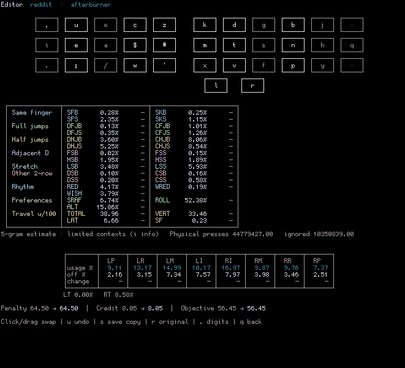

# akler

TUI keyboard layout ranker, editor and optimizer with magic-key support.
Scores layouts from cached n-grams (no ordered corpus traversal). Supports
mouse drag and drop; middle-click hides ranker rows and columns.



## Build and run

```sh
cargo build --release
ln -sf target/release/akler akler
./akler
```

A corpus is included. To add your own, put text in `corpus/raw/` and use
**Corpora → Import text corpus**. Layouts live in `layouts/`; the format is
detected from file contents. Settings live in [akler.conf](akler.conf).

## Documentation

- [Usage, settings and corpora](doc/USAGE.md)
- [Metrics and weights](doc/METRICS.md)
- [AKL.GG stat set](doc/AKLGG.md)
- [Layout files, magic and adaptive keys](doc/LAYOUTS.md)
- [Alternate fingers](doc/ALTFINGERS.md)
- [Combos](doc/COMBOS.md)
- [Magic designer and magic optimizer](doc/MAGIC.md)
- [Weakness report](doc/WEAKNESSES.md)

## Development

```sh
rustfmt --edition 2021 src/*.rs
cargo test --release -- --test-threads=1
cargo build --release
```

`rustfmt` on `src/*.rs` also covers files loaded with `include!`.
